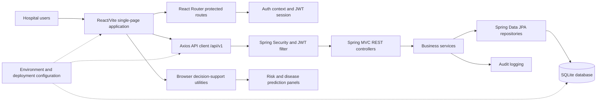
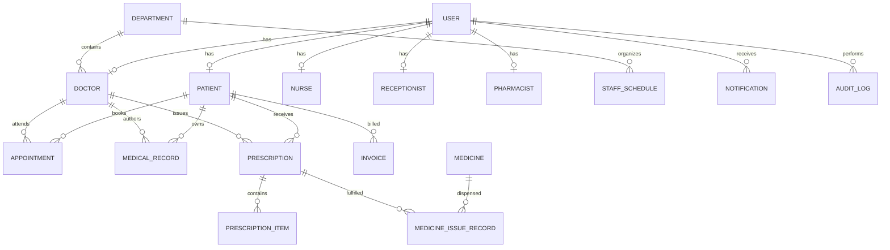

# MediCare360

[](https://react.dev/)
[](https://vite.dev/)
[](https://www.oracle.com/java/)
[](https://spring.io/projects/spring-boot)
[](https://www.sqlite.org/)

MediCare360 is a full-stack hospital management system for coordinating
administrative, clinical, pharmacy, laboratory, billing, and patient workflows.
It provides a React/Vite single-page application, a Java 21/Spring Boot REST API,
SQLite persistence through JPA, JWT-based authentication, and browser-side
clinical decision-support heuristics.

**Repository:** [github.com/code-with-REDDY/MediCare360](https://github.com/code-with-REDDY/MediCare360)

> **Clinical disclaimer:** The decision-support outputs in this project are
> heuristic scores for software demonstration and workflow support. They are
> not diagnoses, medical advice, or substitutes for qualified clinical judgment.

## Table of contents

- [Project overview](#project-overview)
- [Problem statement](#problem-statement)
- [Objectives](#objectives)
- [Key features](#key-features)
- [User roles](#user-roles)
- [System architecture](#system-architecture)
- [Technology stack](#technology-stack)
- [Clinical decision-support module](#clinical-decision-support-module)
- [Database architecture](#database-architecture)
- [Project structure](#project-structure)
- [Application workflows](#application-workflows)
- [Installation and setup](#installation-and-setup)
- [Application screenshots](#application-screenshots)
- [API documentation](#api-documentation)
- [Testing](#testing)
- [Security considerations](#security-considerations)
- [Deployment](#deployment)
- [Future enhancements](#future-enhancements)
- [Limitations](#limitations)
- [Contributing](#contributing)
- [License](#license)
- [Author](#author)

## Project overview

Hospitals coordinate many related activities: patient registration, appointments,
clinical documentation, prescriptions, medicine inventory, billing, reporting,
and communication between departments. MediCare360 centralizes those workflows
behind role-specific portals and a shared REST API.

The current implementation is intended for local development and demonstration.
It supports a Java backend migration from the earlier Python layout and includes
frontend routes and backend services for the primary hospital domains. Some
frontend areas still use local mock adapters, as documented in
[Implementation status](#implementation-status).

## Problem statement

Traditional or fragmented hospital systems can create:

- Manual administrative processes and duplicated data entry.
- Patient information spread across departments and screens.
- Appointment scheduling and status-tracking difficulties.
- Slow communication between reception, clinical, pharmacy, and billing teams.
- Limited visibility into inventory, financial, and operational metrics.
- Little or no explainable data-driven support for clinical review.

MediCare360 addresses these problems with role-based access, shared domain
records, REST APIs, operational dashboards, and transparent browser-side
decision-support calculations.

## Objectives

- Centralize hospital operational data and workflows.
- Provide role-specific interfaces for clinical and administrative teams.
- Protect API access with authentication, authorization, and password hashing.
- Support appointments, medical records, prescriptions, inventory, invoices,
  notifications, audit logs, and reports.
- Provide explainable clinical decision-support signals from available patient
  information without presenting them as diagnoses.
- Keep local setup straightforward with SQLite and documented runner scripts.
- Provide deployment configuration for a static frontend and a packaged backend.

## Key features

### Authentication and authorization

- Admin setup, registration, login, form-based login, token refresh, logout,
  current-user lookup, and account checks.
- JWT access and refresh tokens with token type, user ID, role, JTI, issued-at,
  and expiry claims.
- BCrypt password hashing.
- Role checks in frontend protected routes and authoritative backend method
  authorization with Spring Security.

### Administration

- User, doctor, patient, staff, department, appointment, billing, pharmacy,
  report, audit-log, and system-settings screens.
- Department role assignments and operational dashboards.
- Admin-only user and audit-log operations.

### Patient management

- Patient registration and profile management.
- Patient search and current-patient endpoints.
- Appointments, medical records, prescriptions, bills, notifications, and
  patient dashboard views.

### Doctor management

- Doctor profiles, departments, schedules, appointments, patient lists,
  diagnosis entry, prescriptions, and notifications.
- Predictive risk panel for reviewing ranked patient risk indicators.

### Nursing and reception

- Nurse dashboards, assigned-patient views, vitals/monitoring screens, and
  nursing tasks.
- Receptionist registration, appointment management, doctor availability,
  billing, and patient search screens.

### Pharmacy and medicine inventory

- Medicine inventory and low-stock views.
- Stock updates and medicine issue/dispensing records.
- Prescription review and pharmacy workflows.

### Laboratory technician portal

- Laboratory dashboard, patient sample view, and test-record screens.
- The current repository contains the lab frontend portal; no dedicated
  Java laboratory entity/controller/service was verified.

### Records, billing, notifications, and reporting

- Medical records, diagnoses, vitals, prescriptions, prescription items,
  invoices, payment status, notifications, audit logs, and dashboard reports.
- Backend controllers expose CRUD and reporting operations for the domains
  listed in [API documentation](#api-documentation).

### Clinical decision support

- Weighted symptom/diagnosis matching for five authored condition profiles.
- Explainable patient risk scoring based on demographics, clinical history,
  selected vitals, chronic conditions, and appointment attendance.
- Explicit UI messaging that results require clinical review.

## User roles

| Role | Responsibilities | Verified functionality |
|---|---|---|
| Administrator | Configure the system and manage operations | Users, doctors, patients, staff, departments, appointments, billing, pharmacy, reports, audit logs, settings |
| Doctor | Review patients and document care | Dashboard, profile, appointments, patients, diagnosis, medical records, prescriptions, schedule, notifications, risk panel |
| Nurse | Monitor assigned patients and support inpatient workflows | Dashboard, assigned patients, monitoring/vitals views, nursing tasks, notifications |
| Receptionist | Manage intake and front-desk operations | Patient registration, appointments, availability, billing, patient search |
| Pharmacist | Manage medicines and dispensing | Dashboard, inventory, low-stock view, prescriptions, issue records |
| Laboratory technician | Manage laboratory-facing workflow screens | Dashboard, patient samples, test records; backend laboratory API not verified |
| Patient | Access personal care and administrative information | Dashboard, profile, appointment booking, medical records, prescriptions, bills, notifications |

## System architecture



The frontend sends authenticated requests through the Axios client. The
backend validates JWTs, applies role and method authorization, invokes service
logic, persists entities through JPA repositories, and returns JSON responses.
The two decision-support utilities execute in the browser over data available
to the current UI; they are not backend model-serving endpoints.

## Technology stack

| Area | Verified technologies |
|---|---|
| Frontend | React 19, Vite 6, React Router 7, Tailwind CSS 3, Axios, Recharts, Lucide React |
| Backend | Java 21, Spring Boot 3.2.5, Spring MVC, Spring Data JPA, Bean Validation |
| Languages | JavaScript/JSX, Java, CSS, SQL/SQLite, PowerShell |
| Database | SQLite, Xerial SQLite JDBC, Hibernate Community SQLite Dialect |
| Security | Spring Security, JWT via JJWT 0.12.6, BCrypt |
| Mapping and build | MapStruct 1.5.5, Lombok, Maven |
| Decision support | Browser-side JavaScript weighted heuristics; no Python ML package or serialized model verified |
| Development | npm, Maven, Vite, PowerShell runner scripts |
| Deployment | Netlify configuration for the frontend; Railway and Procfile configuration for the backend |

## Clinical decision-support module

The repository contains two browser-side utilities:

- [`diseasePredictionModel.js`](frontend/src/utils/diseasePredictionModel.js)
- [`patientRiskModel.js`](frontend/src/utils/patientRiskModel.js)

### Disease prediction utility

**Problem addressed:** rank a small set of possible condition profiles from
symptoms, diagnosis text, and selected vital signs.

**Algorithm and inputs:**

1. Normalize symptoms and diagnosis text to lowercase.
2. Match authored keywords for five profiles:
   upper respiratory infection, influenza-like illness, asthma exacerbation,
   gastroenteritis, and hypertension.
3. Add weighted scores for matched keywords.
4. Add fixed signals for temperature at least `100.4`, systolic blood pressure
   at least `140`, and SpO₂ below `95` for the relevant profiles.
5. Apply softmax to the profile scores.
6. Return up to three matched results with a normalized score of at least 10.

The returned `confidence` value is a normalized heuristic score. It is not a
calibrated clinical probability.

### Patient risk utility

**Problem addressed:** provide an explainable triage-style ranking for patient
review in the doctor interface.

The additive score uses:

| Signal | Points |
|---|---:|
| Age 65 or older | 20 |
| Chronic conditions | 15 each, capped at 30 |
| High-risk term in clinical history | 25 |
| Latest SpO₂ below 94 | 20 |
| Heart rate below 50 or above 110 | 15 |
| Missed, no-show, or cancelled appointment | 10 |

The result is capped at 100 and classified as **Low** below 30, **Moderate**
from 30 through 59, or **High** at 60 or above.

### What is not implemented

No training script, dataset, model artifact, TensorFlow/scikit-learn dependency,
evaluation metric, calibration process, fairness analysis, medical ontology,
or clinical validation evidence was found. These utilities should therefore be
described as deterministic, explainable decision-support heuristics rather than
trained or validated machine-learning models.

## Database architecture

### Database technology

The Java backend uses SQLite through Xerial JDBC and Hibernate Community
Dialects. The runtime database path is provided by `MEDICARE_DB_PATH`, with a
relative local fallback in
[`application.properties`](java-backend/src/main/resources/application.properties).
The local database and journal files are ignored by Git.

### Main entities and relationships



The detailed entity relationship documentation is in
[`database/medicare360-erd.md`](database/medicare360-erd.md). Known schema
caveats include polymorphic staff schedule references, prescription items
storing medicine names instead of a medicine foreign key, generic audit
resource IDs, and SQLite-specific constraint limitations.

### Initialization and migrations

Database migration documentation and the Alembic-era migration files are under
[`database/`](database/). The Java application currently uses
`spring.jpa.hibernate.ddl-auto=none`; no Java Flyway or Liquibase configuration
was verified. Database initialization and migration procedures should therefore
be validated against the target environment before production use.

## Project structure

```text
MediCare360/
├── frontend/
│   ├── public/                 # Static assets and SPA redirect rules
│   ├── src/
│   │   ├── components/        # Shared, landing, layout, and doctor components
│   │   ├── context/            # Auth, data, and theme contexts
│   │   ├── pages/              # Public and role-specific portal pages
│   │   ├── routes/             # Route declarations and protected routing
│   │   ├── services/           # API and local/mock service adapters
│   │   └── utils/              # Storage, formatting, role, and decision support
│   ├── package.json            # Frontend dependencies and scripts
│   └── vite.config.js          # Vite development/build configuration
├── java-backend/
│   ├── src/main/java/com/medicare360/
│   │   ├── controller/         # REST endpoints
│   │   ├── dto/                # Request and response DTOs
│   │   ├── entity/             # JPA entities
│   │   ├── repository/         # Spring Data repositories
│   │   ├── service/            # Domain and business services
│   │   ├── security/           # JWT, principals, and security configuration
│   │   └── exception/          # API exception handling
│   ├── src/main/resources/     # Spring configuration
│   ├── src/test/               # Java unit tests
│   └── pom.xml                 # Maven build and dependencies
├── database/                   # ERD and migration documentation/files
├── migration-docs/             # Migration and API contract documentation
├── run-backend.ps1             # Windows backend runner
├── run-frontend.ps1            # Windows frontend runner
├── test-api-suite.ps1          # PowerShell API/RBAC checks
├── Procfile                    # Backend process command
├── railway.toml                # Railway configuration
├── netlify.toml                # Netlify configuration
└── README.md
```

Local SQLite files under `data/` and database journal files are runtime
artifacts and are intentionally not part of the repository.

## Application workflows

### Authentication

Users authenticate through the frontend login or registration screens. The
frontend calls the auth service, stores the returned session token in browser
storage, and the Axios client attaches it to API requests. The backend JWT
filter validates the token before controller and method-level authorization.
Refresh and logout endpoints support session lifecycle management.

### Administration

An administrator manages users, staff profiles, departments, doctors, patients,
appointments, billing, pharmacy records, reports, audit logs, and system
settings through the protected admin portal.

### Doctor

Doctors review dashboards, patients, appointments, and clinical records; add
diagnoses; issue prescriptions; manage schedules; and review the explainable
patient-risk panel.

### Patient

Patients view their profile, book appointments, review medical records and
prescriptions, inspect bills, and read notifications.

### Nurse

Nurses access assigned-patient and monitoring views and nursing task screens.
The dedicated frontend workflow exists, while a separate nurse-task backend
domain was not verified.

### Receptionist

Receptionists register patients, manage appointments and availability, search
patients, and support intake billing.

### Pharmacist

Pharmacists inspect inventory and low-stock medicines, review prescriptions,
update stock, and record medicine issue/dispensing activity.

### Laboratory technician

Laboratory technicians can access the dashboard, patient samples, and test
records frontend screens. A dedicated laboratory REST domain was not verified
in the Java backend.

### Decision support

The doctor-facing UI passes currently available patient records, appointments,
demographics, and selected vitals to the browser-side utilities. The utilities
return ranked heuristic results and contributing indicators for clinician
review; they do not persist or serve trained models.

## Installation and setup

### Prerequisites

- Node.js 18 or newer.
- Java 21 JDK.
- Maven 3.9 or newer for backend builds and tests.
- Git.

### Clone the repository

```powershell
git clone https://github.com/code-with-REDDY/MediCare360.git
cd MediCare360
```

### Configure the backend

The backend reads these runtime environment variables:

| Variable | Purpose | Local example |
|---|---|---|
| `MEDICARE_DB_PATH` | SQLite database file | `..\data\medicare360.db` |
| `JWT_SECRET_KEY` | JWT signing secret; use a random value of at least 32 characters | Set locally; never commit it |

PowerShell example:

```powershell
$env:MEDICARE_DB_PATH = "$PWD\data\medicare360.db"
$env:JWT_SECRET_KEY = "<generate-a-random-secret-of-at-least-32-characters>"
```

Do not commit `.env` files, database files, JWT secrets, real patient data, or
production credentials. The committed environment examples are templates only.

### Install frontend dependencies

```powershell
cd frontend
npm install
```

The frontend API client uses `/api/v1` by default and supports runtime/Vite
API URL overrides. Review
[`frontend/src/services/apiClient.js`](frontend/src/services/apiClient.js)
before deploying the frontend separately from the backend.

### Run the application on Windows

From the repository root:

```powershell
.\run-backend.ps1
```

In a second terminal:

```powershell
.\run-frontend.ps1
```

The frontend is available at `http://localhost:3000`. The backend is available
at `http://localhost:8080`; verify it with:

```powershell
Invoke-WebRequest http://localhost:8080/health
```

### Run directly

```powershell
cd java-backend
mvn spring-boot:run

cd ..\frontend
npm run dev
```

No separate ML dependency installation or model download is required: the
decision-support utilities are JavaScript source modules bundled with the
frontend.

## Application screenshots

Screenshots are not included in the repository yet. Add reviewed, sanitized
images to a future documentation-assets directory before linking them here.

| Screen | Placeholder |
|---|---|
| Landing page | _Screenshot to be added_ |
| Admin dashboard | _Screenshot to be added_ |
| Doctor dashboard | _Screenshot to be added_ |
| Patient dashboard | _Screenshot to be added_ |
| Appointment management | _Screenshot to be added_ |
| Decision-support interface | _Screenshot to be added_ |
| Pharmacy management | _Screenshot to be added_ |

Do not publish screenshots containing real patient records, tokens, credentials,
or other personal information.

## API documentation

The backend base path is `/api/v1` unless noted. The health endpoint is
`/health`.

| Area | Implemented endpoints |
|---|---|
| Authentication | `/auth/check-admin`, `/auth/setup-admin`, `/auth/register`, `/auth/login`, `/auth/login/form`, `/auth/refresh`, `/auth/logout`, `/auth/me` |
| Patients | `/patients` CRUD and `/patients/me` |
| Doctors | `/doctors` create/list/filter/detail/update |
| Appointments | `/appointments` CRUD and status update |
| Medical records | `/medical-records` create/list/filter/detail/update |
| Prescriptions | `/prescriptions` create/list/detail/update and item operations |
| Billing | `/billing` invoice create/list/detail/update/status |
| Pharmacy | `/pharmacy/medicines`, low-stock, stock updates, issue/dispense operations |
| Departments | `/departments` CRUD and role assignments |
| Users | `/users/me` and admin user operations |
| Staff | `/staff` nurses, receptionists, pharmacists, and schedules |
| Reports | `/reports` patient, appointment, billing, pharmacy, and dashboard reports |
| Notifications | `/notifications` list, mark-read, mark-all-read |
| Audit logs | `/audit-logs` admin-only listing |

For request and response details, see the controller classes under
[`java-backend/src/main/java/com/medicare360/controller/`](java-backend/src/main/java/com/medicare360/controller/)
and the DTOs under
[`java-backend/src/main/java/com/medicare360/dto/`](java-backend/src/main/java/com/medicare360/dto/).

### Implementation status

The following areas require additional integration or verification before being
described as fully production-backed:

- Notifications and medical records frontend services include local/mock
  adapters.
- Some department operations include local fallback behavior.
- Laboratory technician screens do not have a dedicated Java laboratory API
  domain.
- Nurse monitoring/task screens do not have a dedicated backend domain verified.
- The forgot-password UI does not have a corresponding password-reset endpoint
  verified in the backend.
- Deployment documentation and Java configuration differ on CORS and database
  validation settings.

## Testing

### Java unit tests

The backend includes tests for authentication, department services, and JWT
services:

```powershell
cd java-backend
mvn test
```

### API and RBAC checks

Start the backend, return to the repository root, and run:

```powershell
powershell -ExecutionPolicy Bypass -File .\test-api-suite.ps1
```

The suite covers health, authentication, role enforcement, patients,
departments, doctors, appointments, notifications, token refresh, logout, and
token blacklist behavior.

### Frontend validation

The frontend currently exposes build and development scripts, but no frontend
test script is defined in `frontend/package.json`:

```powershell
cd frontend
npm run build
```

Test pass status should be verified in the target environment; deployment
configuration currently skips Maven tests during the Railway build.

## Security considerations

- Spring Security provides stateless request protection with a JWT filter.
- BCrypt is used for password hashing.
- Backend method authorization uses role checks such as `@PreAuthorize`.
- JWT signing keys must be provided through environment configuration and must
  never be committed.
- Frontend tokens are stored in browser `localStorage`; deployments should
  evaluate the associated XSS and session-storage risks.
- SQLite files may contain sensitive healthcare data and are ignored by Git.
- Do not use the example environment values in production.
- Audit logs and medical records require strict access controls and sanitized
  operational backups.
- No healthcare compliance certification or security audit is claimed by this
  repository.

Before production use, replace weak development fallbacks, externalize CORS
configuration, validate database migration strategy, add security testing, and
review privacy, retention, access, and incident-response requirements.

## Deployment

### Frontend

The root and frontend Netlify configuration builds from the `frontend`
directory and configures SPA fallback behavior. A typical deployment should:

1. Connect the repository to Netlify.
2. Set the frontend base directory to `frontend`.
3. Run `npm install` and `npm run build`.
4. Publish the generated `dist` directory.
5. Configure the deployed API base URL and backend CORS origin.

### Backend

[`railway.toml`](railway.toml) and [`Procfile`](Procfile) configure deployment
of the packaged Spring Boot JAR. A production deployment must provide:

- Java 21 runtime.
- `MEDICARE_DB_PATH` or a production database strategy.
- A strong `JWT_SECRET_KEY`.
- Correct CORS origins for the deployed frontend.
- A persistent storage strategy for any SQLite database.

The Railway configuration currently skips tests during its build. Run the
backend test suite separately in CI before deployment.

## Future enhancements

The following are proposed improvements, not current functionality:

- Replace heuristics with clinically reviewed, calibrated models and a
  governed model-training/evaluation pipeline.
- Add medical report and longitudinal-record analysis with privacy controls.
- Add predictive resource and bed-capacity planning.
- Add intelligent appointment scheduling and queue optimization.
- Add medical image analysis only after appropriate datasets, validation,
  safety review, and deployment governance are established.
- Add richer analytics dashboards and exportable operational reports.
- Add dedicated laboratory and nursing backend domains.
- Add Java-native versioned migrations and automated schema validation.
- Add frontend tests, backend integration tests, CI security scanning, and
  contract tests.

## Limitations

- The decision-support utilities are hand-authored keyword and threshold
  heuristics with no training data, validation metrics, calibration, or
  clinical approval.
- Only five condition profiles are defined in the disease-ranking utility.
- Frontend mock adapters and incomplete backend domains mean some screens are
  not fully end-to-end connected.
- SQLite and the current schema configuration are better suited to local
  development than a high-availability hospital deployment.
- Deployment and CORS configuration require environment-specific verification.
- The application has not been presented as compliant with a healthcare,
  privacy, or security certification.

Clinical decisions must always be made by qualified professionals using
appropriate clinical evidence. Never use this software as a standalone
diagnostic system.

## Contributing

1. Create a feature branch from `main`.
2. Keep changes focused and document behavior changes.
3. Never commit secrets, local databases, generated build output, or patient
   information.
4. Run `npm run build` for frontend changes.
5. Run `mvn test` and the API suite for backend/API changes where the required
   tools and environment are available.
6. Update documentation and tests with behavior changes.
7. Open a pull request describing the change, validation performed, and any
   deployment or migration implications.

## License

No `LICENSE` file or explicit open-source license was found in the repository.
All rights are therefore reserved by default unless the project owner adds a
license.

## Author

[code-with-REDDY](https://github.com/code-with-REDDY)
