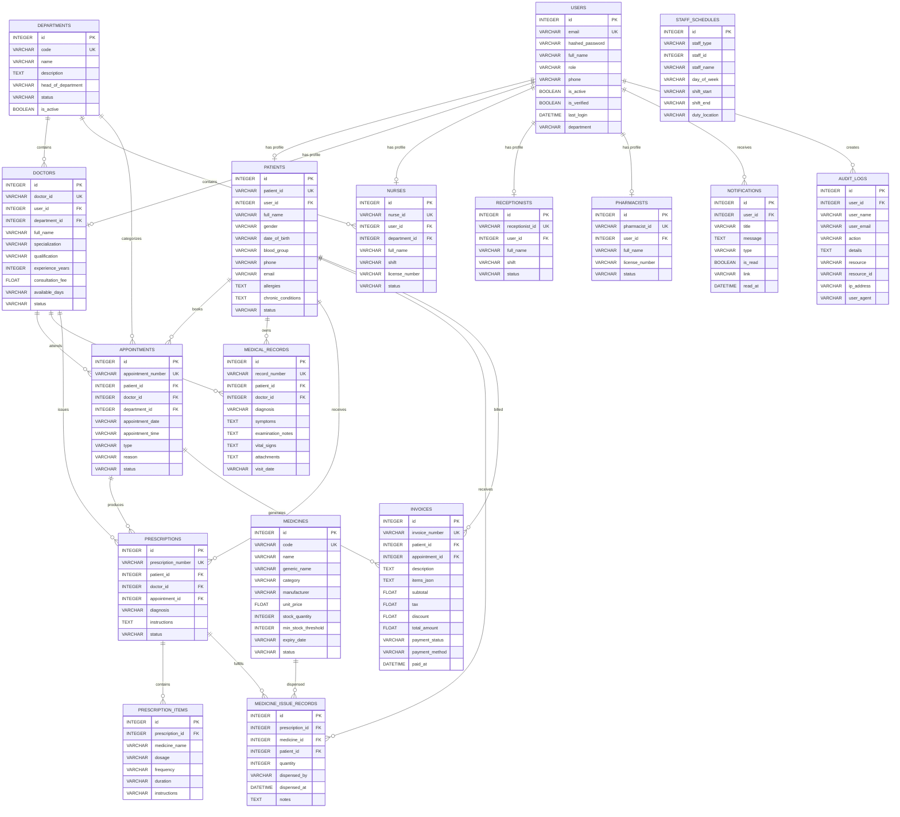

# MediCare360 Database Entity-Relationship Diagram

This diagram reflects the SQLite database at `data/medicare360.db` and the
Spring JPA entity mappings. It excludes the technical `alembic_version` table.

## Relationship caveats

- `staff_schedules.staff_id` and `staff_type` form a polymorphic reference and
  have no database foreign-key constraint.
- `prescription_items.medicine_name` is stored as text; it does not reference
  `medicines.id`. The inventory link is represented by
  `medicine_issue_records.medicine_id`.
- `audit_logs.resource_id` is a generic text identifier rather than a foreign
  key to one specific resource table.
- The role-profile links (`users` to patients, doctors, nurses, receptionists,
  and pharmacists) are modeled as optional one-to-zero-or-one relationships in
  the JPA entities, although the SQLite schema does not enforce uniqueness on
  every `user_id` column.
